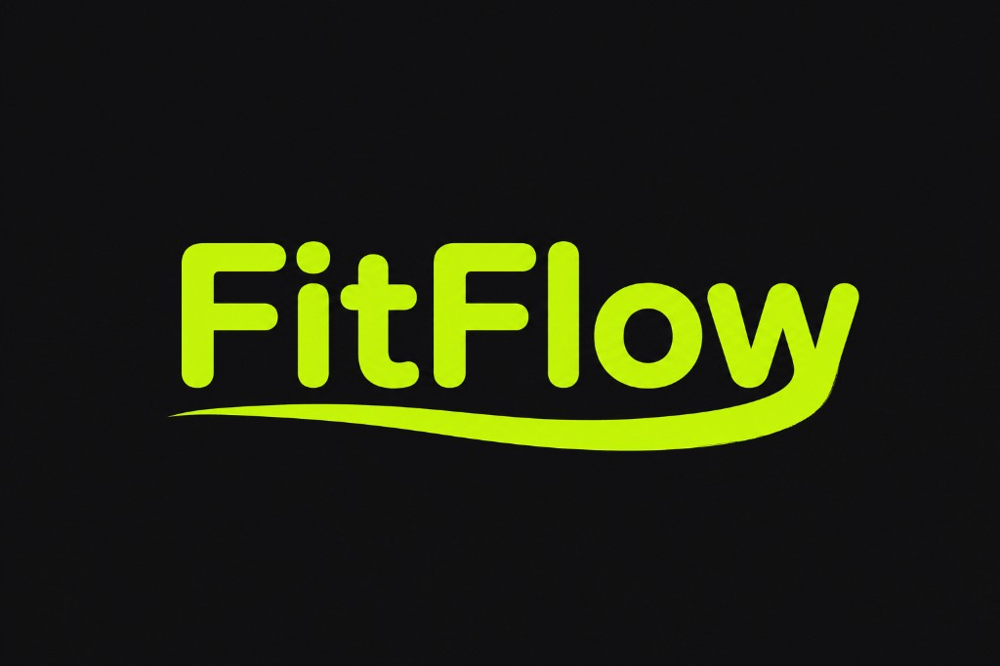
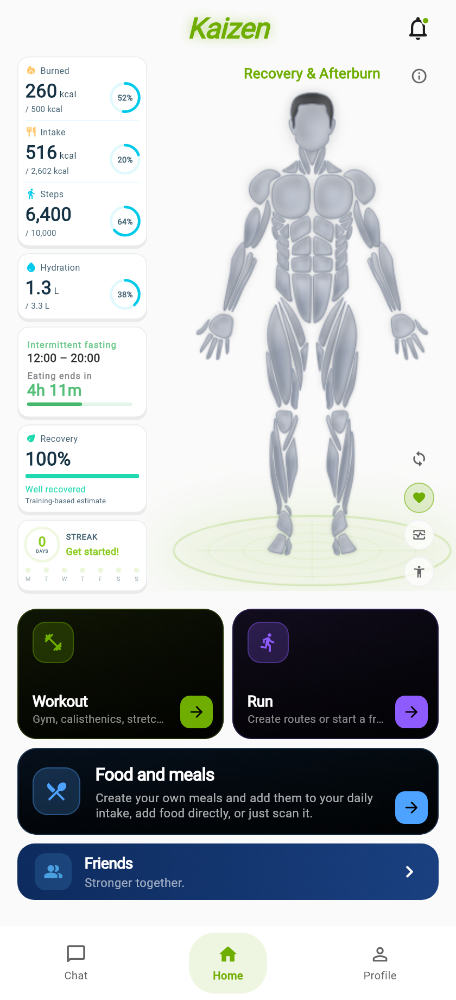
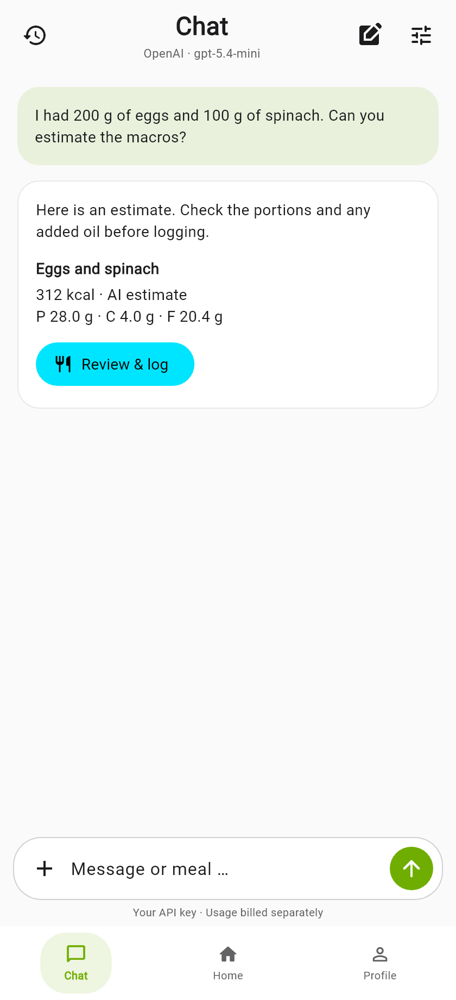
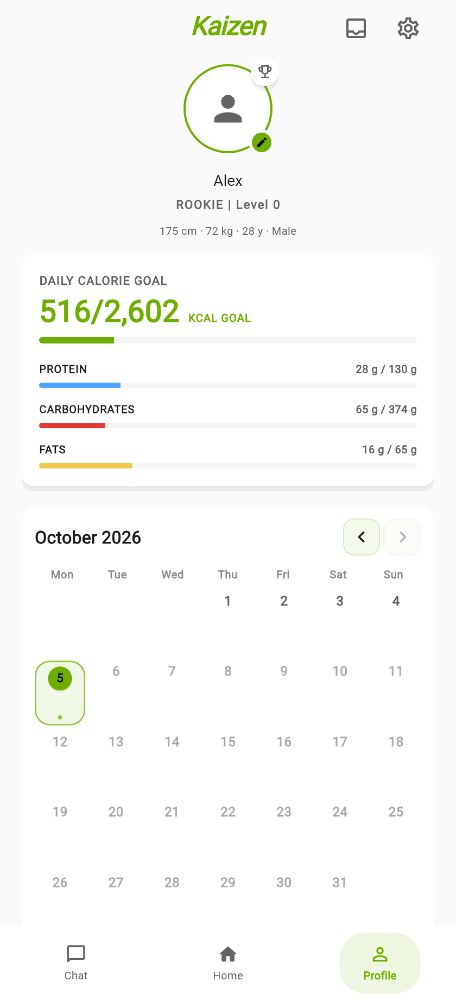

<p align="center"></p>
<h1 align="center">Kaizen</h1>
<p align="center"><a href="https://github.com/JanErcanK/Kaizen/actions/workflows/verify.yml"></a></p>
<p align="center"><strong>Training, nutrition, and progress — in one daily routine.</strong></p>
<p align="center">A Flutter fitness application with an interactive anatomy view, local progress tracking, and an optional AI coach for meals and workouts.</p>
<p align="center">
  <a href="#preview">Preview</a> · <a href="#design-decisions">Design decisions</a> · <a href="docs/GETTING_STARTED.md">Setup</a> ·
  <a href="docs/ARCHITECTURE.md">Architecture</a> · <a href="docs/TESTING.md">Testing</a> ·
  <a href="docs/APP_AUDIT.md">App audit</a> · <a href="docs/RELEASE.md">Release status</a>
</p>

## Why I am building it

Kaizen brings workout planning, food logging, and everyday progress into a shared interface. The aim is to reduce the steps between deciding to train or track a meal and actually recording it.

This repository documents the application and its engineering decisions, including a physical-device rendering fix and the boundary between an imported workout proposal and a confirmed saved plan.

## Preview

<table>
  <tr><th>Daily overview</th><th>Meal assistant</th><th>Profile & progress</th></tr>
  <tr>
    <td></td>
    <td></td>
    <td></td>
  </tr>
</table>

Rendered from actual Flutter widgets using synthetic data. The chat response is a fixture, not evidence of a live provider request. These are portfolio previews, not store device screenshots. [Reproduce the captures](docs/TESTING.md#documentation-screenshots).

## Design decisions

**Why Flutter?** The dashboard combines a custom-painted muscle map with ordinary controls for workouts and meals. Flutter lets these views share Dart models and rendering code across targets. The same widget tree can be rendered against a fixed diary in tests, which is how the previews above were produced. The platform boundary is explicit. Receiving an Android share intent needs Kotlin, and health access needs platform-specific permissions and device checks. [Rendering decision](docs/decisions/001-body-map-rendering.md) · [Widget capture](tool/capture_screenshots_test.dart)

**Why keep the diary in Hive?** A person finishing a workout should be able to log it with no account or network connection. The app reads and writes workouts, food entries and profile data in the local `fitflow_progress` box. Keeping the diary on the device avoids sending each edit to a server. The trade-off is that changing phones does not automatically restore or synchronize that history. Firebase serves a different requirement: two friends need a shared view of a run they choose to share. The social service uses Firebase Authentication and Firestore over REST for those interactions. [Local store](lib/services/progress_store.dart) · [Firebase backend](lib/services/social/firebase_social_backend.dart)

**What happens after “Review & log”?** The chat screen opens an editable meal draft. On confirmation, `ProgressStore.confirmChatMeal` validates the portions, stores them with a receipt keyed by the source message, then notifies the dashboard. A guard catches a second tap while the write is in progress. The persisted receipt catches a retry after restarting the app. A regression test exercises both cases and checks the original day's nutrient totals. [Review sheet](lib/screens/chat_meal_review_sheet.dart) · [Confirmation test](test/ai_chat_test.dart)

## What the app does

| Area | Implemented functionality |
| --- | --- |
| Training | Preset and custom workouts, calisthenics, guided workout sessions, schedules and exercise statistics |
| Body map | Interactive muscle/recovery views plus skeleton, connective tissue and organs; expandable 3D view, exercise selection and movable detail cards |
| Nutrition | Food and dish logging, barcode lookup, daily macro totals, optional water tracking and an eating-window display |
| Progress & health | Unified Profile charts for local nutrition/activity and optional Health Connect / Apple Health imports, weight history, achievements and reminders |
| Running & friends | Route planning, friend codes, shared content, live-running views and monthly challenges; online services require configuration |
| AI coach | OpenAI or Claude with a user-supplied API key; meal photos, workout proposals, saved chats and optional fitness-context analysis |
| Share to Chat | Android sharing opens Chat and prepares videos or public Instagram image/carousel posts for analysis; workout proposals require confirmation before saving |
| Preferences | English and German, light and dark themes; new installations start in English and light mode |

Core tracking uses local storage. Online features have separate network and configuration requirements; see [data flows](docs/DATA_AND_PRIVACY.md). Nutrition and recovery displays are estimates for general fitness use.

Current validation is recorded in [verification evidence](docs/release/VERIFICATION.md). The [application audit](docs/APP_AUDIT.md) retains earlier findings; submission requirements are tracked separately in [release preparation](docs/RELEASE.md).

Instagram import uses publicly available post media and supports up to 20 carousel slides in their original order. Private, restricted or unavailable content requires an attached file or screenshots. It does not sign into Instagram or guarantee every Reel can be downloaded. [Import behavior and limits](docs/AI_CHAT.md#android-share-to-coach-and-video-proposals).

## Engineering highlights

- **Bounded rendering during zoom.** The body-map paint cache limits raster dimensions and reuses the result during gestures. A narrowly scoped Android renderer workaround addresses an observed Motorola driver crash. [Decision and trade-offs](docs/decisions/001-body-map-rendering.md).
- **Confirmation before persistence.** AI output is parsed into a validated meal draft. The user can edit portions and nutrients; only confirmation writes food entries. Duplicate confirmation is guarded by a durable source receipt. [AI architecture](docs/AI_CHAT.md).
- **Keys separated from chat history.** Provider credentials use platform secure storage; conversations and pictures remain in app-local storage. Provider changes start a new conversation. [Storage boundaries](docs/DATA_AND_PRIVACY.md).
- **Explicit social consent and resilient imports.** Accepted friendships control location access, runs have a sharing choice, and durable receipts prevent duplicate workout/dish imports. Emulator tests cover allowed and denied cloud operations. [Design, tests and deployment limits](docs/SOCIAL_FEATURES.md).
- **Regression tests for real failure modes.** Coverage includes body-map gestures and disposal, tab navigation, preference migration, provider payloads, invalid model output and repeated meal confirmation. [Verification and limitations](docs/TESTING.md).

## Try the project locally

You can clone Kaizen and run the tests without a GitHub account or API keys. See [rights and permission](LICENSE.md) for reuse terms.

The project uses **Flutter 3.44.8 / Dart 3.12.2**. With Git and Flutter installed, run the following commands.

```sh
git clone https://github.com/JanErcanK/Kaizen.git
cd Kaizen
flutter pub get
flutter gen-l10n
flutter test
```

To explore the app on Android, start an emulator or connect a phone with USB debugging enabled. Run `flutter devices`, then `flutter run -d DEVICE_ID` with the ID from the list. For Android SDK setup, optional services and troubleshooting, see [Getting started](docs/GETTING_STARTED.md).

## Project structure

```text
lib/
  screens/       Application screens, onboarding and dialogs
  widgets/       Body map, dashboard, workout and shared UI components
  services/      Persistence, calculations, providers and native integrations
    social/      Firebase Auth / Firestore REST integration
  models/        Domain objects and validated AI meal drafts
  navigation/    Logical tab IDs and display order
  l10n/          English/German localization resources
  theme/         Shared colors and appearance
test/            Unit and widget regression tests
tool/            Development utilities and documentation capture
assets/          App illustrations, exercise images and prototype assets
android/, ios/   Native application projects
docs/            Setup, design decisions, verification and release guidance
```

## Platform and release status

| Platform / integration | Current evidence |
| --- | --- |
| Android | Latest release APK built on 2026-10-25; earlier body-map fix checked on a Motorola razr 60 ultra. Latest share/carousel build still needs a physical-device check |
| Windows | Development preview, with platform-specific plugin handling; not a store target in this release plan |
| iOS | Native project present; no Xcode archive or physical-iPhone verification yet |
| OpenAI / Claude | Mocked request/response tests pass; funded end-to-end API testing remains outstanding |
| Instagram import | Supplied nine-image post downloaded and decoded successfully; ordered AI payload and confirmation behavior covered by tests |
| Store publication | Preparation in progress; no claim of Play Store or App Store approval |

See the [release checklist](docs/RELEASE.md) for current blockers. Presence of other Flutter platform folders does not imply verified support. Existing analyzer warnings are tracked separately from test results.

## Documentation

- [Documentation index](docs/README.md) — choose an entry point by task.
- [Getting started](docs/GETTING_STARTED.md) — environment, configuration and first run.
- [Architecture](docs/ARCHITECTURE.md) — modules, data flow and trade-offs.
- [AI chat](docs/AI_CHAT.md) — providers, shared videos/carousels, workout proposals, validation and confirmation.
- [Testing](docs/TESTING.md) — commands, coverage and device checks.
- [Data and privacy](docs/DATA_AND_PRIVACY.md) — technical data inventory and unresolved release work.
- [Release preparation](docs/RELEASE.md) — Android and iOS requirements.
- [Changelog](CHANGELOG.md) · [Third-party notices](docs/THIRD_PARTY_NOTICES.md).

## Author and rights

Created by [JanErcanK](https://github.com/JanErcanK). This repository is a portfolio project, not an open-source release. **Reuse of the author's work requires prior express written permission.** Third-party components retain their own licenses. See [LICENSE.md](LICENSE.md).
