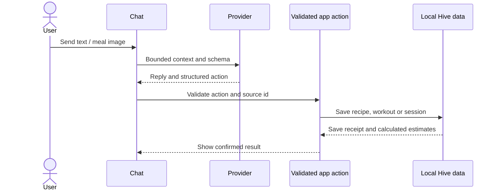

# AI chat, food and workout actions

## Current scope

The app calls OpenAI's Responses API or Anthropic's Messages API directly with a user-supplied API key. This is not a ChatGPT/Claude account login and does not consume a consumer subscription allowance. API usage may be billed separately by the provider. See [OpenAI billing](https://help.openai.com/en/articles/9039756-managing-billing-for-chatgpt-and-the-api-platform) and [Anthropic API billing](https://support.claude.com/en/articles/8977456-how-do-i-pay-for-my-claude-api-usage).

Defaults in `lib/models/ai_chat.dart` are `gpt-5.4-mini` and `claude-haiku-4-5`. The editable model field requires a model supporting the adapter's structured-output format. Arbitrary model names are not guaranteed to work. Google and Meta providers are not implemented. Both providers use the same validated action schema; app-side code executes the action, so the provider does not receive arbitrary access to the device or local database.

The app validates every structured action before it writes local data. Live requests require the user's configured API key and can incur provider charges.

## User flow

1. Open Chat, select OpenAI or Claude in settings and save that provider's API key. Saving a key does not send a request.
2. Send a message. The provider returns a reply plus a constrained action value when the user asks for a recipe or reusable workout, or reports a completed workout.
3. The app validates the action and saves it locally. Saving the same message again uses a source receipt and does not create another recipe, workout or session.

Chats remain available locally. Deleting a chat removes its local images but retains saved food and workout data. Provider/model changes start a new conversation. The assistant has no browsing access. Users can enable fitness context in the introduction or AI settings; it is off by default. This exposes an allowlisted profile and recent daily summary plus bounded on-demand lookups of workouts, workout history, dishes, food intake, shopping lists, weight, supplements, imported health readings and route statistics. Keys, other chats, friends, photos and GPS coordinates are excluded.

Food ideas or described dishes are saved as editable entries under **Gerichte/Meals**. Each entry contains a name, ingredient portions, macros and recipe/preparation text. The app derives extra nutrients and micronutrients with `FoodNutrientEstimator`; those figures are estimates based on food-name categories, not laboratory values or verified product labels. A meal is also added to today's food log when the user says it was eaten.

Requested reusable workout plans are stored in the user's gym or calisthenics workout library. The app stores each exercise, sets/reps, main and secondary muscle groups, plus an estimated duration and calorie burn. Exercise sets support up to 100 per exercise, including circuit rounds. A reported completed workout is instead stored as a one-off calendar/history event; its calorie estimate uses the reported/estimated duration and profile weight. The stored muscle groups feed the recovery mannequin through `MuscleActivityService`.

## Barcode entry

The empty Chat screen offers **Scan the barcode** immediately below **Add a meal photo**. Existing conversations keep a scanner shortcut beside the history control. This uses the same scanner and product sheet as Food: mobile camera or manual barcode entry, an Open Food Facts lookup, editable grams, and actions for the shopping list, today's intake, or a saved/new dish. It does not access an AI key or send a chat request. Only the selected action writes data; adding to shopping or a dish does not count as eating.

The lookup can be cancelled, and a late response cannot reopen a result or close a later route. Connection errors offer an explicit retry. Adding a product to shopping dismisses the product sheet and exposes the confirmation's **Open** action.

## Request and image limits

`AiChatService` includes up to 20 recent messages and approximately 24,000 characters. The latest available photo and latest set of up to 48 visual samples in that context can be resent for follow-ups; older attachments become omission markers. Local history can be longer than transmitted history.

The image pipeline rejects source files over 25 MB, decodes/resizes to a longest edge of 1,280 pixels, re-encodes PNG and rejects output over 4 MB. Re-encoding drops source metadata; native buffers are disposed. Text input is limited to 8,000 characters. Requests allow up to 4,096 output tokens and time out after 90 seconds.

Fixed HTTPS provider endpoints do not follow redirects. There are no automatic billable retries. A question may request up to three local data lookups, each followed by another provider call (at most four provider calls per user send). An explicit retry may incur another charge. Cancellation closes the local request but cannot guarantee the provider stops processing or billing it.

OpenAI requests set `store: false`; this does not promise zero retention. Processing and retention depend on the provider and account terms.

## Response contract and action validation

The top-level schema includes `reply` and `action`. Action type is `none`, `save_dish`, `log_meal`, `save_workout`, `log_workout`, `save_shopping_list`, `remember` or `read_fitness_data`. `targetId` revises an existing workout, dish or shopping list after explicit review. Missing targets are rejected. Workout revisions preserve unedited exercise metadata. Food objects contain an ingredient name, portion grams and protein/carbohydrate/fat totals for that portion. Workout objects contain the routine name/category, duration estimate and exercises with sets, reps, main group and secondary muscle groups. Muscle names use the app's canonical German group values in both language modes. Unused action fields are present but empty.

Validation rejects invalid numeric types, non-finite or negative values, empty names, excessive portions and implausible macro mass. Recipes accept 1–30 foods. Workout actions accept 1–30 exercises, up to 100 sets per exercise, up to 999 reps per set, and an estimated duration from 1–360 minutes. Calories for recipes use the existing 4/4/9 calculation; workout calorie estimates use `CalorieBurnService` and the available profile weight.

These checks enforce structure and basic plausibility, not nutritional accuracy. A picture cannot reliably reveal weight, hidden oil or every ingredient. The app retains recipe assumptions and marks nutrients as estimates; model output is not a verified food-database record.

## Persistence and errors

AI recipes, reusable workouts and one-off workout events keep a source-message receipt so a retried request does not normally duplicate the saved item. `ProgressStore.confirmChatMeal` separately records eaten meal portions and its receipt. The app stores these records locally in Hive; this is not a server-side sync guarantee.

Failed/interrupted requests remain distinguishable from successful replies. Authentication, quota, model, transport and malformed-response errors do not write food. Raw provider error bodies are not displayed or logged by this service because they may contain sensitive details.

API references: [OpenAI structured outputs](https://developers.openai.com/api/docs/guides/structured-outputs), [OpenAI function calling](https://developers.openai.com/api/docs/guides/function-calling), [OpenAI images](https://developers.openai.com/api/docs/guides/images-vision), [Anthropic structured outputs](https://platform.claude.com/docs/en/build-with-claude/structured-outputs), [Anthropic tool use](https://platform.claude.com/docs/en/agents-and-tools/tool-use/overview), [Anthropic vision](https://platform.claude.com/docs/en/build-with-claude/vision).

## Android share-to-coach and video proposals

Android registers SEND for text/plain, image/* and video/*, plus SEND_MULTIPLE for images. Incoming content is copied via the sender's temporary content-URI grant into a private durable inbox and acknowledged only after the chat is persisted. No broad storage permission is requested. Cold and warm intents route to a fresh Coach chat; completed import IDs prevent duplicate chats after interrupted acknowledgement. iOS share extensions are not included.

Direct videos up to 3 minutes / 128 MB are sampled locally with MediaMetadataRetriever (up to 48 JPEG frames, maximum 768 px dimensions). Images are re-encoded. The original copied share is deleted after import; analysis samples stay with the chat and are removed when it is deleted. No audio or transcription is supplied, and the model is explicitly told this. Screenshots have no fabricated timestamps. The Android video button can append a file from the system gallery picker.

Instagram, TikTok and YouTube usually share URLs. Instagram imports try Open Graph/VideoObject metadata and the public embed's exact post context. The requested shortcode must match; cover images and unrelated posts cannot substitute for missing content. Single images and complete carousels of up to 20 slides are supported, preserving their order and slide numbers. `img_index` denotes the selected viewing position; the whole carousel is analyzed so other exercises are retained. Mixed posts keep images and videos distinct, with a shared limit of 48 analysis samples. A missing slide fails the import instead of silently analyzing an incomplete routine.

Downloads follow at most four redirects per request, validate HTTPS Instagram/Meta CDN hosts, cap page sizes at 4 MB, images at 25 MB and total downloaded media at 128 MB, and time out. Images are decoded/re-encoded and videos are sampled locally; source files are then deleted. No third-party downloader, login session or AI key is sent to Instagram. Access depends on what Instagram exposes publicly; private posts, login/rate-limit pages and unsupported links produce an explicit attachment request without a paid AI call. TikTok/YouTube links still require an attached video or screenshots. A URL or thumbnail alone is never treated as analyzed video.

On Android cold starts, the launch intent is delivered when the Flutter engine channel is configured, because FlutterFragment attaches after Activity.onCreate. Warm intents use onNewIntent; resuming also refreshes the durable inbox. Chat navigation runs after layout and synchronizes the PageView even if the selected tab already says Chat. Shared inputs bypass the introductory slideshow, appear immediately with progress, and automatically submit actual video frames to the configured AI provider. Missing API credentials retain the message for an explicit retry after setup.

Video conversations always retain actions as proposals. Even an erroneous log_workout response becomes a reusable workout proposal, never an activity log. Proposal cards show exercises, quantities and evidence/uncertainty, with Save and Change controls. Revisions supersede earlier unsaved proposals; saved receipts prevent double saves. Time-based intervals currently remain in the explanation; the model must request clarification rather than silently converting seconds into repetitions.

## Personalization and first visit

The three-step introduction is shown only when the Chat tab becomes visible: meal photos (estimated macros and micros), fitness coaching and personalization, then a gold video-import page. Completion persists locally. The data toggle is explicit and can be disabled in AI settings. Durable coach notes are only proposed for explicit memory requests, require a save button and can be deleted individually in settings. Other conversations are never automatically included.

The current snapshot refreshes for each request. Detailed reads use allowlisted datasets, substring filters and pagination, limited to 20 records / approximately 24,000 characters per page. Oversized records are marked omitted. Missing measurements are unknown; multiple health sources are not combined. Fitness data is context, not model training or a promise of provider-side memory.

With fitness sharing enabled, every request also receives an eight-week training analysis. `CoachTrainingAnalysis` aggregates all recorded sessions in 56 local calendar days into eight seven-day windows and compares the recent 28 days with the preceding 28. Summaries include logged sessions/days, duration with coverage, direct muscle sets and training days, running distance/pace, logged-day nutrition means and measured weight means. Missing set counts or loads never receive exercise-editor defaults. Exercise observations retain timestamps and session IDs; descriptive rep changes require equal recorded external load and set count on different days. Stored session exercise snapshots do not independently verify completed sets. Eight exercise trends are included directly; additional trends can be retrieved through the bounded `trainingAnalysis` dataset.

The snapshot also includes the body map's current recovery heuristic and separate 14-day means for each imported sleep, resting-heart-rate and HRV source, with measured-day counts. Sources are not summed. The coaching prompt requests 2–4 prioritized adjustments for the next 1–2 weeks, grounded in actual dates/exercises/numbers and paired with a way to check progress. Sparse logs, partial nutrition days, missing load and heuristic recovery must be qualified. Analysis does not create memories or automatically change workouts. Provider response quality still requires live API evaluation; local tests verify the aggregate calculations and both provider request/lookup paths.

Validation: targeted Flutter tests cover opt-in context, bounded lookups, both provider image formats, proposal persistence/confirmation, idempotent writes, URL-only fallback, first-visit visibility and existing meal/barcode/workout flows. Real provider accuracy and Android share flows on a physical phone require device/API testing.

2026-10-25 share fix verification: 39 tests passed across coach imports, cold/warm share navigation, public-video resolution, AI chat and barcode flows. The release APK builds successfully. A live check of `https://www.instagram.com/reel/DLlr-y4Rxkq/` returned a public HTML page but no downloadable video metadata; its public embed page also provided no video URL. Therefore this clip exercises the attachment-required fallback, not successful video analysis. Public-link import is best effort and does not guarantee arbitrary Instagram reels. No physical device was connected and no live AI request was made. The optional `dart run tool/check_public_video.dart <URL>` check downloads only public media, deletes temporary files and reports whether a video was available.

2026-10-25 carousel follow-up: the supplied `https://www.instagram.com/p/De3BL_pCByI/?img_index=6` is a nine-image carousel. Its exact supplied URL was successfully downloaded and processed through the real importer and image decoder: all nine slides, in order, produced 6,665,979 bytes of PNG analysis images. The explicit live diagnostic is `flutter test tool/check_instagram_import_test.dart`; it never calls an AI provider or reads API keys. The regression suite now passes 47 tests, including all nine images entering a mocked AI request, slide-number persistence and saving only after confirmation. Actual provider analysis and the device share sheet remain separate manual checks.
