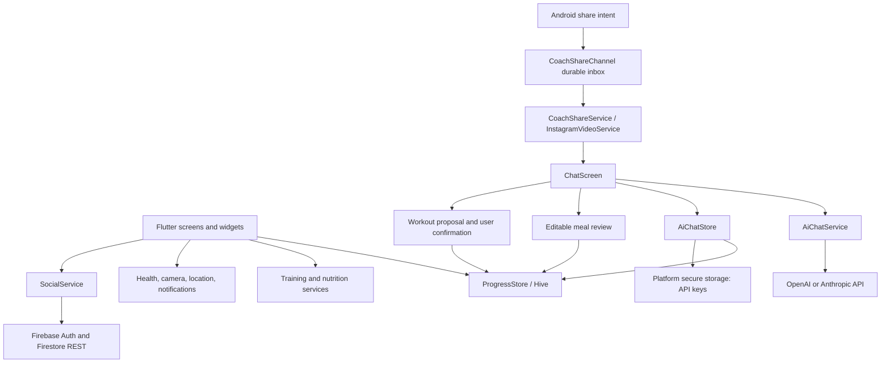

# Architecture

Kaizen is a Flutter application organized by technical responsibility. It uses app-local Hive storage and service classes rather than a repository-wide state-management framework. Native projects provide platform permissions, signing and plugin integration.

## Application lifecycle and navigation

`lib/main.dart` initializes persistence, notifications and the optional social service, then starts `KaizenApp`. `AppBootstrap` selects onboarding or `RootShell`. `ProgressStore` exposes a revision notifier so interested widgets can rebuild when persisted fitness state changes.

The bottom bar displays **Chat · Home · Profile**. Logical tab IDs remain Home `0`, Profile `1`, Chat `2`; `AppTabNavigation.visualOrder` maps them to visible order. Keeping IDs stable preserves existing internal links. A fresh shell starts at Home. Profile resets its scroll position when selected.

Incoming Android shares select Chat instead. The launch intent is delivered from `configureFlutterEngine` because the Flutter fragment can attach after `onCreate`; warm shares arrive through `onNewIntent`. The durable inbox is refreshed on resume, navigation is synchronized after layout, and import IDs prevent duplicate chats. Acknowledgement follows local chat persistence.

## Persistence and state

`ProgressStore` owns the `fitflow_progress` Hive box and much of the domain persistence. Workouts, profile data, nutrition entries, preferences and AI conversation metadata are local. `AiChatStore` manages conversations and image files; credentials use platform secure storage separately.

Chat history writes deliberately do not broadcast the global progress notifier. A confirmed meal does, because dashboard nutrition totals must update. Preference changes are persisted for subsequent sessions.

This is a practical architecture for the current project, but `ProgressStore` is large and tightly coupled to some screens. Splitting persistence behind smaller domain interfaces is a future refactoring opportunity. This is not presented as a complete clean-architecture implementation.

## Domain services

| Responsibility | Main entry points |
| --- | --- |
| Workouts and progress | `ProgressStore`, workout screens and exercise configuration |
| Recovery/body-map display | `MuscleActivityService`, `RecoveryBodyMap`, `CachedBodyPaint` |
| Nutrition | `NutritionCalculator`, `FoodNutrients`, `OpenFoodFactsService` |
| AI coach and proposals | `AiChatService`, `AiChatAction`, `CoachContextService`, `CoachTrainingAnalysis`, `ChatMealReviewSheet` |
| Shared-media import | Native `CoachShareChannel`, `CoachShareService`, `InstagramVideoService`, `ChatImageService` |
| Unified health charts | `HealthDashboardService`, `ProfileHealthData`, `ProfileHealthCard` |
| Steps and sleep | `HealthStepsService`, `HealthSleepService` |
| Scheduling | `TrainingNotificationService`, `IntermittentFastingService` |
| Friends and shared content | `SocialService`, `SocialStore`, `FirebaseSocialBackend` |
| Walking routes | `RoutingService`, OpenRouteService and OpenStreetMap tiles |

Social features use Firebase REST endpoints, not FlutterFire. Anonymous identity and refresh state are persisted by the social store. Core local data is not a general cloud-synced account.

[Social features](SOCIAL_FEATURES.md) documents recipient-confirmed friendships, per-run location consent, polling/heartbeat intervals, bounded paths, ordered stop/delete, masked Firestore updates and durable content-import receipts. Client and rule upgrades must be coordinated; the local rules are not proof of production deployment.

## Rendering and platform boundaries

The body map is drawn from path data with custom painters. `CachedBodyPaint` rasterizes expensive shading at a bounded size, then displays the cached result while gestures scale it. Size, theme and meaningful painter-state changes invalidate the cache; native image handles are disposed. The [rendering decision](decisions/001-body-map-rendering.md) documents the trade-offs and the native workaround.

The integrated Babylon.js anatomy viewer uses bundled models and a loopback asset server. `AnatomyWebView` has Windows and Android/iOS native adapters, with test/fallback behavior where a native view is unavailable. Muscle, skeleton, connective-tissue and organ modes share a Flutter bridge for selections, training overlays and movable cards. The earlier arm prototype remains a separate asset experiment. Adapter presence does not establish iOS or physical-phone rendering verification; see the dated [testing evidence](TESTING.md).

Android permissions and renderer selection live in the Android host. iOS has HealthKit entitlements and usage descriptions, but an Xcode build and device verification remain required. Generated platform folders are not evidence of feature parity.

## Boundaries worth preserving

- Model responses cannot write meals directly; user review is the persistence boundary.
- Shared-media workouts always remain proposals until confirmed, including AI responses incorrectly labelled as a completed workout. Carousel slide numbers and video timestamps remain distinct evidence.
- API keys never belong in Hive conversation data or source-controlled settings.
- Provider/model changes start a new chat, avoiding silent transfer of an existing history to another provider.
- Body-map gestures must not cause raster allocation proportional to zoom.
- Development previews and mocks cannot substitute for native release testing.

## Next engineering work

Priorities are live provider verification, store-facing privacy/consent/reporting/deletion flows, a reproducible iOS archive, clearer asset provenance, and reduced analyzer debt. Longer-term work includes narrower persistence interfaces, consistent localization and explicit schema migrations as stored models evolve. These items are not represented as complete.
